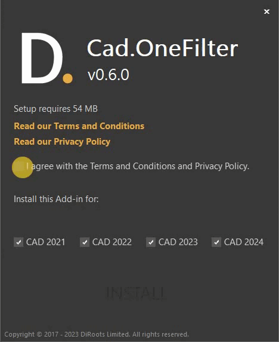
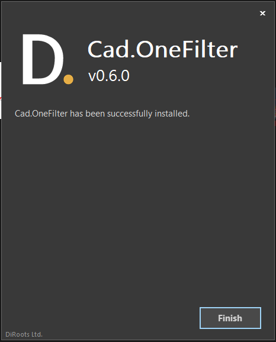
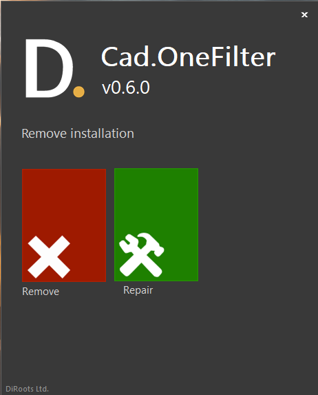
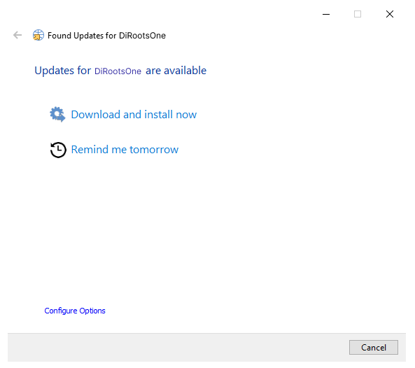

# Getting Started
{: .no_toc }

Install DiRootsOne for AutoCAD to filter objects and layers by type, layer, or property.

## Table of contents
{: .no_toc .text-delta }

1. TOC
{:toc}

---

## Download

Download the [latest version of DiRootsOne](https://diroots.com/autocad-plugins/dirootsone-for-autocad/).

## Install

### Compatibility

- Windows 7, 8, 10, and 11.
- AutoCAD 2021, 2022, 2023, 2024, 2025, and 2026.

### Standard Installation

> This method is ideal for individuals who want to install DiRootsOne on one computer.
{: .note }

1. Run the DiRootsOne installer.

2. Select the AutoCAD versions and click **Install**.

   

3. Wait for the installation to complete and click **Finish**.

   

### Silent Installation

> This method is ideal for IT administrators who want to deploy DiRootsOne to multiple computers.
{: .note }

- Install for all compatible AutoCAD versions:

```bat
<installer-name>.exe /i // /qn accept_eula=1
```

- Exclude specific AutoCAD versions. This example excludes AutoCAD 2021, 2022, and 2023:

```bat
<installer-name>.exe /i // /qn accept_eula=1 autocad2021="" autocad2022="" autocad2023=""
```

## Uninstall

### Using the installer user interface

1. Run the DiRootsOne installer.

2. Select the AutoCAD versions and click **Remove**.

   

3. Wait for the uninstallation to complete and click **Finish**.

### Using the installer silently

Uninstall DiRootsOne without user interaction:

```bat
<installer-name>.exe /x // /qn
```

### From the Control Panel

1. In the taskbar search box, type **Control Panel** and open it.

2. Select **Programs > Programs and Features**.

3. Right-click the program you want to remove and select **Uninstall** or **Uninstall/Change**, then follow the prompts.

## Updates

DiRootsOne includes an updater that checks for new versions when AutoCAD closes. It lets you install the update or be reminded the next day.



### Updater Settings

You can adjust the update check frequency (two days by default) and the download folder.

> Automatic update checks can't be disabled in the user interface. You can reduce how often they run by setting the check frequency to 365 days.
{: .new }

> 
{: .warning }

> IT administrators can change the update check frequency in the updater configuration file.
{: .new }

1. Go to `%programdata%\DiRoots.DiRootsOne\Settings`.

2. Open `updater.ini`.

3. Find `CheckFrequency=2` and change the value, for example, to `365`.

> We recommend keeping DiRootsOne up to date. Support is not provided for outdated versions.
{: .warning }
