# By Rules
{: .no_toc }

The By Rules tab applies filter rule sets with **AND** and **OR** conditions. Choose whether to search the Whole Model, Current Selection, or Active Space.

## Table of contents
{: .no_toc .text-delta }

1. TOC
{:toc}

---

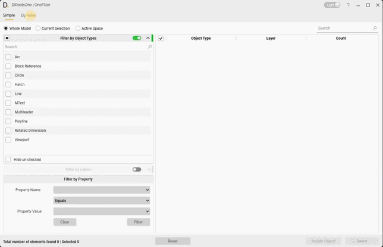

> The image may show an earlier version of [OneFilter for AutoCAD](https://diroots.com/autocad-plugins/dirootsone-for-autocad/).
{: .note }

## Rule Sets

One rule set is created by default. You can edit it or create additional rule sets.

1. Click **New** to create a rule set.

   > Double-click a rule set to rename it.
   {: .note }

   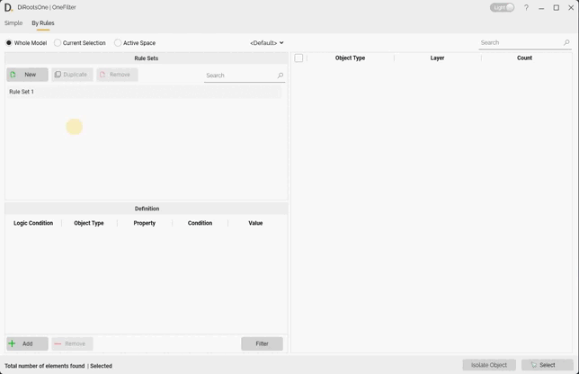

   > The image may show an earlier version of [OneFilter for AutoCAD](https://diroots.com/autocad-plugins/dirootsone-for-autocad/).
   {: .note }

2. Select a rule set and click **Duplicate**.

   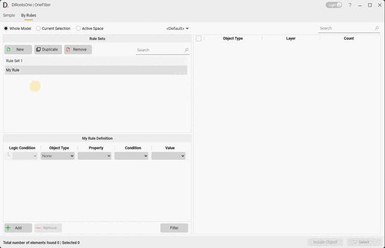

   > The image may show an earlier version of [OneFilter for AutoCAD](https://diroots.com/autocad-plugins/dirootsone-for-autocad/).
   {: .note }

3. Select a rule set and click **Remove**.

   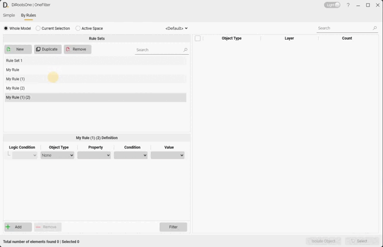

   > The image may show an earlier version of [OneFilter for AutoCAD](https://diroots.com/autocad-plugins/dirootsone-for-autocad/).
   {: .note }

> Use the search box to find rule sets.
{: .note }

## Definition

This tab allows you to create specific filter conditions for each rule. For this, select a rule from the table above to allow you to edit the filter settings.

1. Open the first drop-down list and choose Object Types.

2. Select the second drop-down list to choose the properties of the selected objects.

3. Choose the Condition to apply filter.

4. Enter a value or select a suggested value from the drop-down list.

Click **Filter** to run the condition rule.

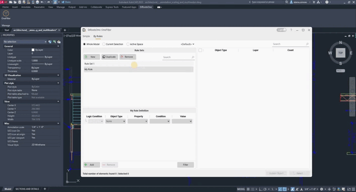  
> The image may show an earlier version of [OneFilter for AutoCAD](https://diroots.com/autocad-plugins/dirootsone-for-autocad/).
{: .note }

### Add condition

You can also apply more conditions to your rule. Click Add to insert a new definition into your rule, following the "AND/OR" condition.

> Note that if you select the rule created and click Add, you will add a new definition as a child, thus creating a tree structure for your rule.
{: .note }

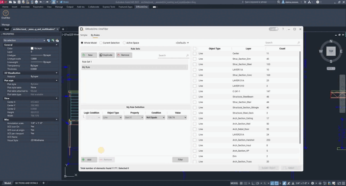  
> The image may show an earlier version of [OneFilter for AutoCAD](https://diroots.com/autocad-plugins/dirootsone-for-autocad/).
{: .note }

### Remove

Select the conditions created and click the Remove button to delete them.

  
> The image may show an earlier version of [OneFilter for AutoCAD](https://diroots.com/autocad-plugins/dirootsone-for-autocad/).
{: .note }

---

### Search

Use the search box to find filtered elements in the main table.

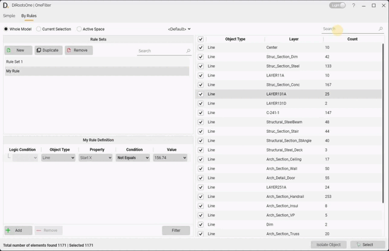  
> The image may show an earlier version of [OneFilter for AutoCAD](https://diroots.com/autocad-plugins/dirootsone-for-autocad/).
{: .note }

### Select

Select the filtered elements with the checkboxes, then click **Select** to select them in the view.

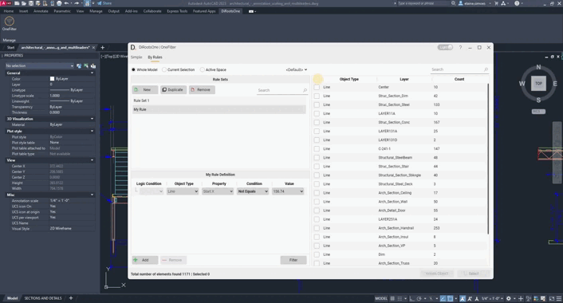  
> The image may show an earlier version of [OneFilter for AutoCAD](https://diroots.com/autocad-plugins/dirootsone-for-autocad/).
{: .note }

### Isolate Objects

Select the filtered elements with the checkboxes, then click **Isolate** to isolate them in the view.

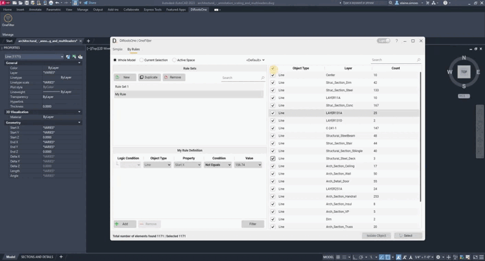  
> The image may show an earlier version of [OneFilter for AutoCAD](https://diroots.com/autocad-plugins/dirootsone-for-autocad/).
{: .note }

> Click End Isolation, or use the AutoCAD command "Unisolate" to return to the entire model view.
{: .note }

---

## Profile

Create profiles to save the rules and conditions created to filter the model in AutoCAD.

### Creating Profiles

OneFilter profiles make it easy to save your settings and reuse them later. It is also a handy way for BIM Managers to create standard rules (e.g., filename conventions) and share them across the organization.

1. Click on the Profile drop-down list.
2. Click on Add New, and enter a Profile name.
3. Click to save the profile.

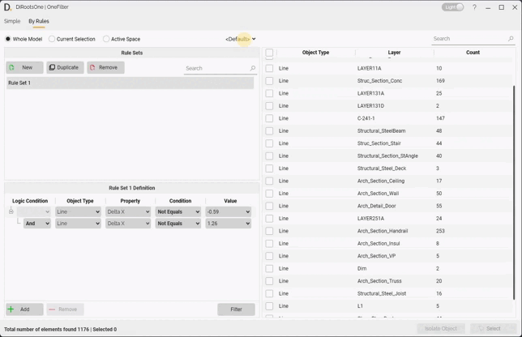  
> The image may show an earlier version of [OneFilter for AutoCAD](https://diroots.com/autocad-plugins/dirootsone-for-autocad/).
{: .note }

> BIM managers can create profiles in a shared network location so users can import the same rules. See [Importing Profiles](#importing-profiles).
{: .new }

### Export Profile

OneFilter profiles make it easy to export profiles to stay compliant with your company standards (e.g., profiles in a network location).

1. Click on the Profile drop-down list and click to export.
2. Use the Windows File Explorer to select a folder to save the profile (e.g., in a shared folder, network location, or local computer).
3. Click on the "Save" button to export the profile.

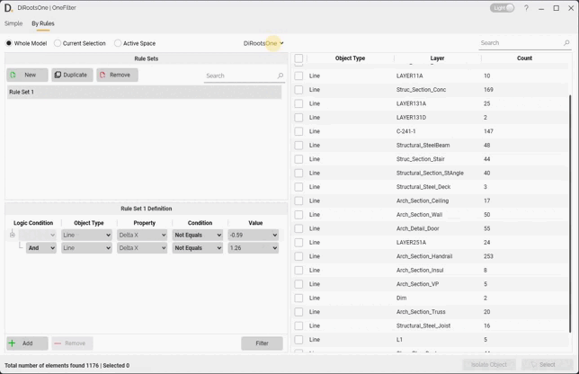  
> The image may show an earlier version of [OneFilter for AutoCAD](https://diroots.com/autocad-plugins/dirootsone-for-autocad/).
{: .note }

### Importing Profiles

OneFilter profiles make it easy to import existing profiles to stay compliant with your company standards (e.g., profiles in a network location).

1. Click on the Profile drop-down list and click to import.
2. Use the Windows File Explorer to find the profile (e.g., in a shared folder, network location, or local computer)
3. Click on the "Open" button to import the profile.

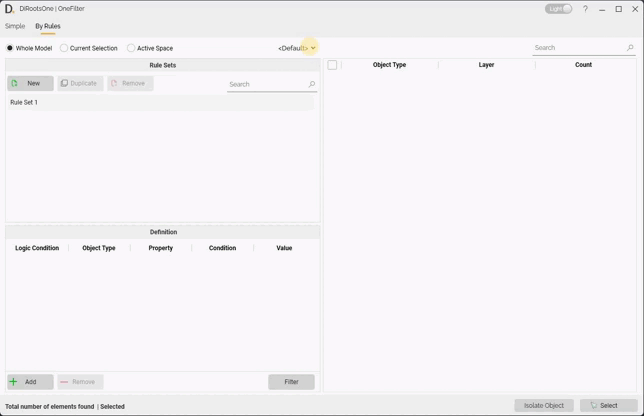  
> The image may show an earlier version of [OneFilter for AutoCAD](https://diroots.com/autocad-plugins/dirootsone-for-autocad/).
{: .note }

### Deleting Profiles

1. Click on the Profile drop-down list.
2. Click on the Delete icon next to the profiles list.
3. Confirm.

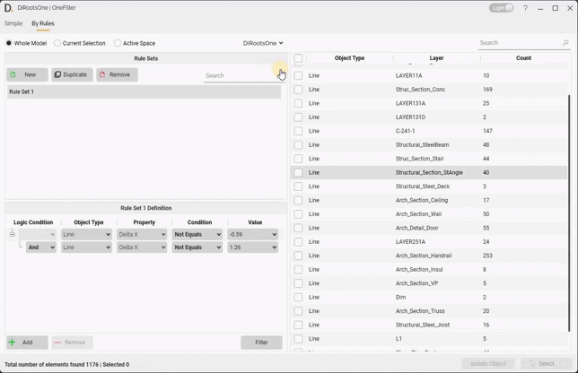  
> The image may show an earlier version of [OneFilter for AutoCAD](https://diroots.com/autocad-plugins/dirootsone-for-autocad/).
{: .note }