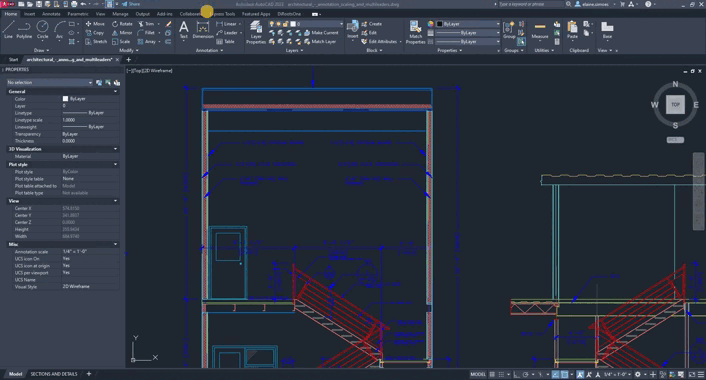
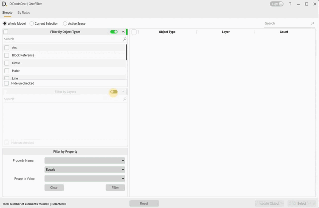
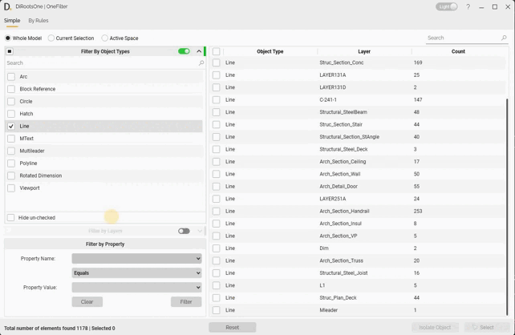
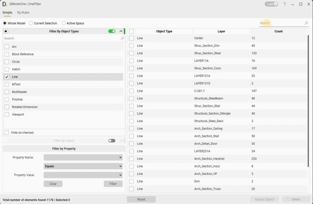
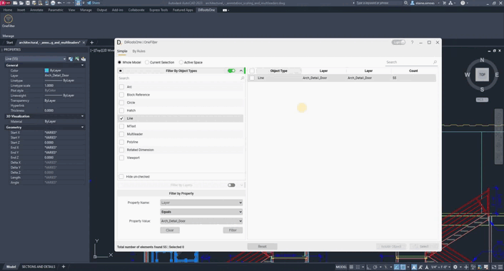
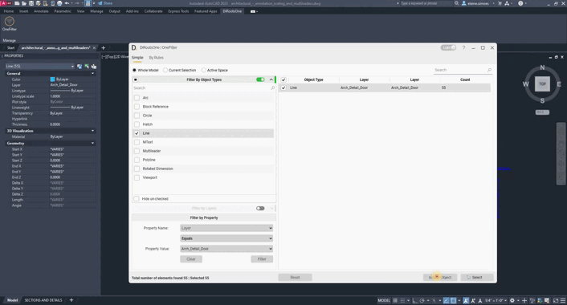
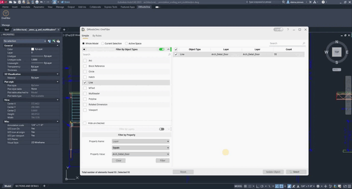

# OneFilter AutoCAD
{: .no_toc }

OneFilter helps you find objects in AutoCAD by filtering objects and layers by their properties.

## Table of contents
{: .no_toc .text-delta }

1. TOC
{:toc}

---

## Simple

The Simple tab filters objects and layers, and lets you refine the results by property.

1. Select whether to filter the Whole Model, the Current Selection, or Active Space.

   

   {: .note }
   The image may show an earlier version of [OneFilter for AutoCAD](https://diroots.com/autocad-plugins/dirootsone-for-autocad/).

2. Activate the Objects and Layers table with the switch in the table header.

3. Select the objects or layers to filter. The matching elements appear in the table on the right.

   {: .note }
   Use the search box to find objects and layers.

   

   {: .note }
   The image may show an earlier version of [OneFilter for AutoCAD](https://diroots.com/autocad-plugins/dirootsone-for-autocad/).

## Filter by Property

Refine the selected objects or layers by choosing a property, condition, and value.

1. Open the first selection list and choose a property.

2. Open the second list and choose a condition.

3. Enter or select a property value, then click **Filter**.

   {: .note }
   Click **Clear** to reset the property filter.

   

   {: .note }
   The image may show an earlier version of [OneFilter for AutoCAD](https://diroots.com/autocad-plugins/dirootsone-for-autocad/).

### Search

Use the search box to find filtered elements in the main table.

{: .note }
The image may show an earlier version of [OneFilter for AutoCAD](https://diroots.com/autocad-plugins/dirootsone-for-autocad/).

### Select

Select elements with the checkboxes, then click **Select** to select them in the view.

{: .note }
The image may show an earlier version of [OneFilter for AutoCAD](https://diroots.com/autocad-plugins/dirootsone-for-autocad/).

### Isolate Objects

Select elements with the checkboxes, then click **Isolate** to isolate them in the view.

{: .note }
The image may show an earlier version of [OneFilter for AutoCAD](https://diroots.com/autocad-plugins/dirootsone-for-autocad/).

{: .note }
Click **End Isolation** or use the AutoCAD `UNISOLATE` command to return to the full model view.

### Reset

Click **Reset** to clear the filtered elements.

{: .note }
The image may show an earlier version of [OneFilter for AutoCAD](https://diroots.com/autocad-plugins/dirootsone-for-autocad/).
